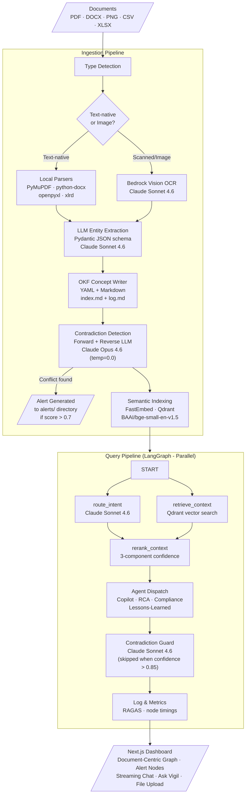

# Vigil

Vigil is an industrial knowledge intelligence platform that detects safety and compliance contradictions in engineering procedures, maintenance logs, and regulatory codes at the moment of ingestion - and answers grounded, cited queries through a multi-agent RAG pipeline powered by Amazon Bedrock.

---

## Architecture Overview

Full data flow from document ingestion through parallel query routing to the streaming frontend dashboard.



---

## Core Differentiator: Proactive Contradiction Detection

Every knowledge management system can search and answer questions reactively. Vigil goes further: when a new document is ingested, it performs a **double-sided contradiction check** against all linked existing concepts in the knowledge graph.

- **Forward check**: The newly ingested concept is compared against every concept it explicitly references.
- **Reverse check**: All existing concepts that reference the new concept are also pulled in and compared.

If a contradiction exceeds a 0.7 confidence threshold, Vigil automatically generates a compliance alert in the `alerts/` directory, linking both conflicting sources with severity and side-by-side comparison. An operator updating a maintenance bypass procedure that violates an OSHA pressure limit is stopped at ingestion time, not during an inspection.

---

## Parallel Query Pipeline

The query pipeline uses a **fan-out/fan-in** LangGraph topology. `route_intent` (LLM classification) and `retrieve_context` (Qdrant vector search) run concurrently from `START`, saving ~300–400ms per query compared to sequential execution.

```
START ──┬── route_intent ─────┐
        └── retrieve_context ──┤
                               ▼
                      rerank_context → agent dispatch → guard → log → END
```

### 3-Component Confidence Model

After retrieval, a mathematically grounded confidence score is computed:

```
relevance  = harmonic_mean(top_k_scores)         # penalizes weak outliers
consensus  = sigmoid(fraction_of_scores > 0.55)  # smooth agreement signal
coverage   = unique_source_files / total_hits    # source diversity

confidence = 0.5 × relevance + 0.3 × consensus + 0.2 × coverage
```

The full breakdown (`relevance`, `consensus`, `coverage`, `formula`) is returned in every API response under `metadata.confidence`.

### Smart Guard Skipping

The contradiction guard LLM call is skipped (saving ~800ms) when any of these conditions are met:

| Condition | Skip Reason in Trace |
|:---|:---|
| No contexts retrieved | `no_contexts` |
| Response is a safety refusal | `refusal_response` |
| `confidence.score > 0.85` AND `consensus > 0.9` | `high_confidence` |
| Response < 50 words | `short_response` |

---

## LLM Routing (Amazon Bedrock)

All LLM calls route through a unified `call_llm(task, ...)` gateway in `shared_utils.py`. Model selection is automatic based on task:

| Task | Model | Reason |
|:---|:---|:---|
| `contradiction` | `claude-opus-4-6-v1` | Highest reasoning for safety-critical detection |
| `topology` | `claude-opus-4-6-v1` | Complex P&ID structural analysis |
| `route_intent` | `claude-sonnet-4-6` | Fast intent classification (max 20 tokens) |
| `extraction` | `claude-sonnet-4-6` | Entity extraction from documents |
| `generation` | `claude-sonnet-4-6` | RAG response generation |
| `ocr` | `claude-sonnet-4-6` | Vision OCR for scanned documents |
| `contradiction_guard` | `claude-sonnet-4-6` | Post-generation safety check |

Cross-region inference profile IDs used:
- Opus: `us.anthropic.claude-opus-4-6-v1`
- Sonnet: `us.anthropic.claude-sonnet-4-6`

**Fallback**: If AWS credentials are not configured, the system automatically falls back to OpenRouter (`meta-llama/llama-3.3-70b-instruct`).

---

## Streaming Chat

Queries to `/api/query/stream` return Server-Sent Events (SSE). Tokens appear on the frontend as Claude generates them - perceived latency drops from a ~20-second blank wait to text appearing in ~2 seconds.

```
event: token  → {"token": "The ", "done": false}
event: token  → {"token": "pressure ", "done": false}
...
event: done   → {"metadata": {"confidence": {...}, "node_metrics": {...}}}
```

---

## Interactive Graph Features

### Document-Centric Graph Architecture

The knowledge graph uses a **document-first** design:

- **Source Document Nodes** (primary): Each uploaded file appears as a distinct, clickable rounded-rectangle card with file-type badge (PDF, CSV, XLSX, etc.) and corner fold icon. These are the main interaction points.
- **Alert Nodes** (interactive): Compliance alerts render as red hexagonal warning shields, clickable with severity indicators. Clicking opens the Inspector with an "Ask Vigil to resolve this" button.
- **Entity Nodes** (decorative): Extracted concepts orbit their parent document as small colored dots. They highlight when their parent document is selected but are not directly clickable.

When no source documents are available (e.g., production without file storage), the graph falls back to making all entity nodes interactive with labeled pill shapes.

### Organized Layout

Toggle "Organized Layout" to snap document nodes into a clean grid at center, with entity nodes arranged in orbital rings around their parent document. Smooth cubic-eased animation transitions between force-directed and organized modes.

### Node Search & Filter

The graph panel includes a search bar that filters nodes in real-time by label, ID, or type. Matching nodes remain fully visible while non-matching nodes fade to 15% opacity, making it easy to locate specific equipment, procedures, or regulations in large knowledge graphs.

### Bidirectional Chat ↔ Graph Linking

- **Graph → Chat**: Clicking any document or alert node opens the Inspector Panel with full description and an **"Ask Vigil about this"** button that sends a contextual query directly to chat.
- **Alert → Chat**: Alert cards in the Alerts tab include an **"Ask Vigil about this"** button — no modal popup, just instant AI analysis of the conflict, risks, and corrective actions.
- **Chat → Graph**: When the AI responds with citations, the cited source nodes glow orange (primary) and their neighbors glow blue (secondary) on the graph via animated impact ripple.
- **Knowledge Base → Graph**: Clicking a source document in the Knowledge Base explorer highlights all its derived entities on the graph.

### Real-Time WebSocket Updates

The backend exposes a WebSocket endpoint at `/ws/updates`. When documents are ingested via the upload pipeline, a `graph_updated` event is broadcast to all connected clients. The frontend:

1. Automatically re-fetches the graph and alerts data
2. Highlights newly added nodes with an orange glow for 5 seconds
3. Reconnects automatically if the connection drops (5-second retry)

This eliminates the need to manually refresh after ingesting new documents.

### Graph Legend & Schema Panel

A collapsible legend panel shows all node types with live counts (Source Documents, Concepts, Procedures, Regulations, Maintenance, Alerts). Auto-opens on desktop, collapsed on mobile.

---

## Real File Upload with Live Pipeline Progress

Uploading documents via `/api/ingest/upload` returns SSE progress events per file:

```
event: file_start    → {"file": "doc.pdf", "index": 0, "total": 2}
event: step          → {"step": 1, "label": "Parsing document...", "status": "running"}
event: step          → {"step": 2, "label": "Extracting entities...", "status": "complete"}
event: contradiction → {"detected": true, "severity": "high", ...}
event: file_complete → {"file": "doc.pdf", "entities_count": 4}
event: done          → {"total_files": 2, "new_node_ids": ["equipment/valve-v-202.md", ...]}
```

After upload completes, the knowledge graph refreshes automatically and newly added nodes glow green for 5 seconds.

---

## Empirical Evaluation & Performance Benchmarks

### 1. Proactive Contradiction Detection (42 labeled pairs, 41 scored)

Benchmark: [tests/contradiction_benchmark.json](tests/contradiction_benchmark.json), 42 concept pairs (21 contradictory, 21 clean). Re-run on 2026-10-12 with Claude Opus 4.6 on Bedrock (temperature 0) at commit `b991e82`. Pair 32 (clean) returned unparseable JSON on 4 of 4 attempts and is excluded, as it was in the 2026-08-24 run, so n = 41 (21 contradictory, 20 clean). The 2026-10-12 run reproduced the 2026-08-24 confusion matrix exactly ([run log](docs/contradiction_benchmark_run_log_2026-08-24.txt)).

| Threshold | TP | FP | TN | FN | Precision | Recall | F1 |
|:---:|:---:|:---:|:---:|:---:|:---:|:---:|:---:|
| 0.5 / 0.6 / 0.7 / 0.8 | 17 | 0 | 20 | 4 | 1.000 | 0.810 | 0.895 |

95% CIs (percentile bootstrap over the 41 pairs, B = 10,000, threshold 0.7):
- Recall: [0.625, 0.955]
- F1: [0.769, 0.977]
- Precision: the bootstrap interval collapses to [1.0, 1.0] because there are 0 false positives, so it says nothing. The exact Clopper-Pearson 95% lower bound for 17/17 is 0.805.

The threshold sweep is flat because `confidence_score` is the model's confidence in its own verdict ("contradiction" or "clean"), not a probability of contradiction. Mean (median) confidence:
- Contradictory pairs: 0.884 (0.95)
- Clean pairs: 0.908 (0.925)

These differ slightly from the 2026-08-24 run (0.880 / 0.905), even at temperature 0.

Results: [docs/eval_runs/2026-10-12/](docs/eval_runs/2026-10-12/) (`contradiction_raw.json`, `contradiction_summary.json`, `contradiction_run_log.txt`).

### 2. QA RAG Performance (40 questions: 30 in-scope, 10 out-of-scope)

Re-run on 2026-10-12 at commit `b991e82`, using the local Qdrant index (`vigil_qdrant.db`, 96 points) with reranking off (the default):
- **Agent:** Claude Sonnet 4.6 on Bedrock.
- **Judge:** Claude Haiku 4.5 on Bedrock, scored with RAGAS 0.4.3 and `BAAI/bge-small-en-v1.5` embeddings.
- **CIs:** 95% percentile bootstrap over questions (B = 10,000).

| Metric | Score | 95% CI |
|:---|:---:|:---:|
| Faithfulness (in-scope, 29 of 30 scored; 1 judge parse failure) | 0.583 | [0.518, 0.650] |
| Answer Relevancy (in-scope, n=30) | 0.612 | [0.464, 0.753] |
| Context Precision (in-scope, n=30) | 0.551 | [0.382, 0.718] |
| Context Recall (in-scope, n=30) | 0.633 | [0.467, 0.800] |
| Correct refusals (out-of-scope, n=10) | 10/10 by manual reading (9/10 by the script's keyword heuristic) | Clopper-Pearson lower bound 0.69 |
| False refusals (in-scope, n=30) | 3/30 (Q13, Q19, Q24), single-reader judgement; Q2 and Q20 are partial answers | n/a |

Results: [docs/eval_runs/2026-10-12/ragas/](docs/eval_runs/2026-10-12/ragas/) (`ragas_scores.csv`, `ragas_answers.jsonl`, `ragas_summary.json`).

The scores reported earlier (faithfulness 0.8112, answer relevancy 0.8307, context precision 0.7197, context recall 0.7167) are **not backed by a saved result file**. [docs/ragas_eval_results.csv](docs/ragas_eval_results.csv) has empty score columns for all 30 rows. The repo script's judge (`openrouter/free`) also routes each call to an unspecified free model. RAGAS scores depend heavily on the judge model, so the new and old numbers cannot be compared directly.

### 3. Retrieval Ablation Study (n=30 questions, no LLM calls)

Re-run on 2026-10-12 with the unmodified `evaluate_retrieval()` against the current local index:

| Method | Hit@5 | MRR |
|:---|:---:|:---:|
| Without reranking | 0.933 | 0.836 |
| With FlashRank | 0.967 | 0.874 |

FlashRank adds +0.033 Hit@5 (one query) and +0.038 MRR. The earlier figures (0.9667/0.8944 without reranking, 1.0/0.9333 with) were measured on an earlier index state, and only the summary in [docs/retrieval_ablation_results.md](docs/retrieval_ablation_results.md) was saved from that run. Results: [docs/eval_runs/2026-10-12/retrieval_ablation.json](docs/eval_runs/2026-10-12/retrieval_ablation.json).

---

## Known Limitations & Engineering Trade-offs

1. **False negatives (4 of 21 contradictory pairs, same in the 2026-08-24 and 2026-10-12 runs)**: pairs 25, 35, 39 and 41. For each one the model returned "no contradiction", with verdict confidence 0.90, 0.30, 0.85 and 0.35. Changing the threshold cannot recover these misses. The category labels in [docs/contradiction_failure_analysis.md](docs/contradiction_failure_analysis.md) (implicit_operational: 25, 35, 37; multi_hop: 23, 39, 41) come from an earlier run with 6 misses. Pairs 23 and 37 are detected in both current runs. The benchmark JSON has no category field, so the taxonomy cannot be recomputed from it.

2. **Unit conversion is not established**: in the earlier run in `contradiction_failure_analysis.md`, clean pairs 32 (PSI vs MPa) and 34 (°C vs °F) were falsely flagged. In both current runs, pair 34 is correctly judged clean. Pair 32 never produced parseable output, and the production code (`check_contradiction`) silently treats a parse failure as "no contradiction" with confidence 0.0.

3. **AI-Assisted Benchmark Bias**: The 42 pairs were constructed with AI assistance. Hard pairs were hand-written to mitigate this; independent external evaluation remains future work.

4. **Small Out-of-Scope Cohort**: 10/10 correct refusals on n=10 gives an exact 95% lower bound of only 0.69. Also, `run_ragas_eval.py` counts an agent exception as a correct refusal, so a crash would raise this metric.

5. **Reranking Disabled on Free-Tier Render**: FlashRank is disabled on the 512MB Render instance to prevent OOM crashes. On the 2026-10-12 index this costs 0.038 MRR (0.874 → 0.836) and 0.033 Hit@5 (0.967 → 0.933).

---

## Document Parsing Performance

| File Type | Method | Notes |
|:---|:---|:---|
| PDF (text-native) | PyMuPDF (primary), pdfplumber (fallback) | No LLM call; 87–98% less extraction time than pdfplumber on the test PDFs |
| PDF (scanned/image) | Claude Sonnet 4.6 vision (Bedrock) | AI-powered OCR with layout understanding |
| DOCX | python-docx | Preserves headings and paragraph structure |
| XLSX / XLS | openpyxl / xlrd | Handles legacy .xls files misencoded as .xlsx |
| CSV | Python csv module | Zero-dependency, deterministic |

Plain text extraction timed on 2026-10-12 on the PDFs in [test_documents/](test_documents/), median of 3 runs, on an 8GB M2 with other processes running, so absolute times are inflated. Results: [docs/eval_runs/2026-10-12/pdf_parse_timing.json](docs/eval_runs/2026-10-12/pdf_parse_timing.json). The earlier table (1.61s vs 0.26s and so on) had no saved result file.

| Document | pdfplumber | PyMuPDF | Time reduction |
|:---|:---:|:---:|:---:|
| 29 CFR 1910.119 (up to date as of 7-01-2026), 317KB | 11.10s | 0.82s | 92.6% |
| osha_1910_119.pdf, 204KB | 13.65s | 0.41s | 97.0% |
| artofthepid-aiche-rbt11-15-19.pdf, 7.0MB | 22.01s | 0.55s | 97.5% |
| 462-Piping-and-Instrumentation-Diagrams.pdf, 3.1MB | 5.60s | 0.24s | 95.6% |
| Emergency_Bypass_Procedure_P101.pdf, 2KB | 0.08s | 0.01s | 86.6% |

---|:---:|:---:|:---:|
| 29 CFR 1910.119 OSHA (316KB) | 1.61s | 0.26s | 83.8% faster |
| P&ID Reference Manual (7MB) | 3.44s | 0.20s | 94.2% faster |
| Piping & Instrumentation Diagrams | 0.80s | 0.15s | 81.2% faster |
| OSHA 1910.119 alternate | 1.50s | 0.17s | 88.6% faster |
| Sample 100KB | 0.04s | 0.02s | 50.0% faster |

---

## Tech Stack

### Backend (Python)

| Layer | Technology | Details |
|:---|:---|:---|
| Agent orchestration | `langgraph` | Parallel fan-out StateGraph: `START → {route_intent ∥ retrieve_context} → rerank_context → agent → guard → log` |
| LLM gateway | `anthropic[bedrock]` | Unified `call_llm(task)` routes to Opus 4.6 or Sonnet 4.6 automatically |
| Primary models | Claude Opus 4.6, Claude Sonnet 4.6 | Via Amazon Bedrock cross-region inference profiles |
| Vision/OCR | Claude Sonnet 4.6 vision (Bedrock) | For scanned documents and P&ID images |
| Fallback LLM | OpenRouter `meta-llama/llama-3.3-70b-instruct` | Used when AWS credentials not configured |
| Local parsers | PyMuPDF, pdfplumber, python-docx, openpyxl, xlrd | Text-native PDFs, DOCX, spreadsheets |
| Knowledge format | Open Knowledge Format (OKF) | YAML frontmatter + Markdown; cross-linked via relative paths; `index.md` + `log.md` per directory. Schema in [AGENTS.md](AGENTS.md) |
| Vector storage | `qdrant-client` | Local SQLite (`vigil_qdrant.db`) or Qdrant Cloud |
| Embeddings | `fastembed` | `BAAI/bge-small-en-v1.5` - shared singleton, no reload on re-index |
| Reranking | `flashrank` | `ms-marco-MiniLM-L-12-v2`; disabled on 512MB instances |
| Confidence model | Custom 3-component formula | `0.5×relevance + 0.3×consensus + 0.2×coverage` |
| Streaming | FastAPI SSE | `/api/query/stream` and `/api/ingest/upload` |
| Evaluation | `ragas` | Faithfulness, context precision/recall, answer relevancy |
| API server | `fastapi` + `uvicorn` | REST + SSE on port 8000 |
| Observability | `langsmith` | Per-node timing, token usage, model used, confidence breakdown |

### Frontend (Next.js)

| Layer | Technology | Details |
|:---|:---|:---|
| Framework | Next.js 16 | App Router |
| Styling | Tailwind CSS 4 | Ivory surfaces, clay accent (`#d97757`), sage green (`#788c5d`), blue (`#6a9bcc`) |
| Animations | `framer-motion` | Tab transitions, layout animations, cubic-eased graph transitions |
| Graph | `react-force-graph-2d` | Canvas-rendered; document cards, alert hexagons, entity dots; custom pointer areas; organized layout mode |
| Graph interaction | Custom draw handlers | `nodeCanvasObject` renders 3 node types; `nodePointerAreaPaint` for accurate hit detection; hover tooltips with type/severity |
| Real-time | WebSocket (`/ws/updates`) | Graph auto-refreshes when new documents are ingested - no manual reload needed |
| Bidirectional linking | Inspector → Chat | "Ask Vigil about this" sends contextual query; alert cards have direct "Ask Vigil" buttons |
| Knowledge Base | File tree explorer | Browse source documents and extracted entities; click to highlight on graph |
| Markdown | Custom renderer | Tables, blockquotes, compliance matrices, RCA tables - all rendered |
| Streaming | Fetch ReadableStream | Chat tokens stream token-by-token; upload progress via SSE |
| File Upload | HTML5 drag-and-drop | Multi-file; 50MB limit; real-time pipeline progress |
| Icons | `lucide-react` | |

---

## Setup

### Prerequisites

- Python 3.11+ (managed via `uv`)
- Node.js 20+
- AWS credentials with Bedrock access (us-east-1)

### 1. Clone and set environment variables

```bash
git clone https://github.com/puranikyashaswin/Vigil.git
cd vigil
cp .env.example .env
```

Edit `.env`:

```env
# Required: Amazon Bedrock (us-east-1, Claude Opus/Sonnet access)
AWS_ACCESS_KEY_ID=AKIA...
AWS_SECRET_ACCESS_KEY=...
AWS_REGION=us-east-1

# Optional: Qdrant Cloud (falls back to local vigil_qdrant.db if not set)
QDRANT_URL=https://your-cluster.qdrant.io
QDRANT_API_KEY=your_qdrant_api_key

# Optional: fallback LLM if AWS not configured
OPENROUTER_API_KEY=sk-or-v1-...

# Optional: LangSmith tracing
LANGSMITH_API_KEY=your_langsmith_key
LANGSMITH_TRACING=true
LANGSMITH_PROJECT=vigil
```

### 2. Install Python dependencies

```bash
uv venv
source .venv/bin/activate
uv pip install -r requirements.txt
```

### 3. Install frontend dependencies

```bash
cd apps/frontend
npm install
```

### 4. Build the knowledge graph and index

Place source documents in `test_documents/`. Then:

```bash
# Parse documents, extract entities, write OKF files, detect contradictions
python apps/backend/scripts/build_graph.py

# Embed and index all OKF files into Qdrant
python apps/backend/scripts/index_graph.py
```

For P&ID diagram topology extraction:

```bash
python pid_topology_extractor.py --input test_documents/your_diagram.png
```

### 5. Start the backend

```bash
python apps/backend/api.py
```

The server starts immediately without loading ML models. Embedding model and Qdrant indexing happen lazily on first query. Set `AUTO_INDEX_ON_STARTUP=1` to pre-index at boot (requires >512MB RAM).

### 6. Start the frontend

```bash
cd apps/frontend
npm run dev
```

Open `http://localhost:3000`.

### 7. Test via CLI (optional)

```bash
# Single query
python test_agents.py "What does OSHA 1910.119 require?"

# Interactive mode
python test_agents.py
```

---

## Cloud Deployment (Render)

Vigil is deployed on Render's free tier. Key configuration:

### Environment Variables (Render)

Set these in **Render → Environment**:

| Variable | Value |
|:---|:---|
| `AWS_ACCESS_KEY_ID` | Your AWS key |
| `AWS_SECRET_ACCESS_KEY` | Your AWS secret |
| `AWS_REGION` | `us-east-1` |
| `QDRANT_URL` | Qdrant Cloud cluster URL |
| `QDRANT_API_KEY` | Qdrant Cloud API key |
| `AUTO_INDEX_ON_STARTUP` | Leave unset on free tier (saves ~350MB RAM) |

### Keep-Alive (Free Tier)

Render free-tier instances sleep after 15 minutes of inactivity. Set up a free UptimeRobot monitor:
- **URL**: your Render backend URL + `/api/health`
- **Interval**: every 5 minutes

This prevents cold-start delays during demos.

### Performance on Free Tier (512MB RAM)

- FlashRank reranking is **disabled** (`ENABLE_RERANKING` not set) to stay within 512MB
- Embedding model is **lazy-loaded** — only instantiated on first query, not at startup. Saves ~350MB of RAM (fastembed + onnxruntime + model weights) until actually needed.
- Auto-indexing on startup is **skipped by default** to prevent OOM. Set `AUTO_INDEX_ON_STARTUP=1` to enable. Indexing happens automatically on first query if the collection is empty.
- Graph, alerts, and stats endpoints serve immediately without loading any ML models.

### Administrative Endpoints

| Endpoint | Purpose |
|:---|:---|
| `GET /api/health` | Health check (used by UptimeRobot) |
| `GET /api/admin/index-all` | Re-embed and upsert all OKF files into Qdrant |
| `GET /api/graph` | Knowledge graph nodes and edges (cached) |
| `POST /api/ingest/upload` | Upload documents with live SSE progress |
| `POST /api/query/stream` | Streaming chat query (SSE) |
| `WS /ws/updates` | WebSocket - broadcasts `graph_updated` events after ingestion |

---

## Running the Evaluation Suites

All source documents in `test_documents/` are git-tracked for exact reproducibility.

```bash
# RAGAS QA evaluation (40 questions - 30 in-scope, 10 out-of-scope)
python apps/backend/scripts/run_ragas_eval.py

# Contradiction detection threshold sweep (42 labeled pairs)
python apps/backend/scripts/run_contradiction_benchmark.py

# Retrieval ablation - Hit@5 and MRR with/without FlashRank (zero API cost)
python apps/backend/scripts/run_retrieval_ablation.py
```

---

## Enterprise Scalability Path

Vigil is architected to scale without rewriting core logic. See [docs/SCALING.md](docs/SCALING.md) for full breakdown.

| Component | Current | Production Upgrade | Bottleneck |
|:---|:---|:---|:---|
| LLM Inference | Amazon Bedrock (on-demand) | Bedrock Provisioned Throughput | Rate limits |
| OCR Processing | Claude Sonnet 4.6 vision | Batch inference / async queue | Processing quotas |
| Vector Index | SQLite-backed Qdrant | Qdrant Cloud clustered | Concurrent query latency |
| Reverse Scanning | Brute-force local scan | Qdrant metadata filter index | Disk I/O |
| Pipeline Runner | Sync background thread | Celery / Temporal async queue | Crash recovery |
| Storage Layer | Local flat directories | Versioned Object Storage (S3) | Directory limits |

---

## Project Structure

```
vigil/
  AGENTS.md                    # Project constitution (conventions, OKF schema)
  README.md                    # This file
  requirements.txt             # Python dependencies (pinned)
  .env / .env.example          # Environment variables
  test_agents.py               # CLI test harness for query agents
  pid_topology_extractor.py    # P&ID vision topology extractor
  dump_static_json.py          # Static JSON exporter for demo/Vercel mode
  apps/
    backend/
      api.py                   # FastAPI server - REST + SSE endpoints
      graph.py                 # LangGraph parallel fan-out pipeline
      nodes.py                 # Agent node functions (Copilot/RCA/Compliance/Lessons)
      state.py                 # AgentState + merge_metadata reducer
      retrieval.py             # Vector search + 3-component confidence model
      shared_utils.py          # Unified LLM gateway - call_llm(), call_llm_vision()
      parsers.py               # Document type detection + local parsers + Bedrock OCR
      admin_utils.py           # Qdrant indexing helper
      scripts/
        build_graph.py         # Full ingestion pipeline
        index_graph.py         # Qdrant embedding + indexing
        contradiction.py       # Contradiction detection (uses call_llm)
        okf_utils.py           # OKF file writing utilities
        run_ragas_eval.py      # RAGAS evaluation runner
        run_contradiction_benchmark.py
        run_retrieval_ablation.py
    frontend/
      src/
        app/
          page.tsx             # Main dashboard - streaming chat, upload, graph
          layout.tsx           # Root layout
          globals.css          # Tailwind theme + custom styles
        components/
          ForceGraph2D.tsx      # Graph canvas - node rendering, tooltips, interaction
          graph/
            graphDrawHandlers.ts # Custom node/link rendering (document, alert, entity)
            graphColors.ts       # Type → color maps (light/dark)
            useOrganizedLayout.ts# Animated grid layout mode
          InspectorPanel.tsx    # Node inspector - description, "Ask Vigil" button
          AlertFeed.tsx         # Alert cards with inline "Ask Vigil" CTA
          KnowledgeBaseExplorer.tsx # File tree + highlight-on-graph
          GraphLegend.tsx       # Node type legend with live counts
          ChatHistoryOverlay.tsx# Streaming chat UI - full markdown rendering
          DocumentSelector.tsx  # Drag-and-drop file upload zone
          PipelineVisualizer.tsx# Real-time SSE pipeline progress
          SidebarPanel.tsx      # Inspector/Alerts/KB tab container
        utils/
          markdown.ts          # Markdown renderer - tables, blockquotes, lists
  knowledge_graph/             # OKF concept files (git-tracked)
    equipment/
    procedures/
    regulations/
    maintenance/
    alerts/
  docs/
    architecture.md
    ragas_results.md
    ragas_eval_results.csv
    contradiction_benchmark_results.md
    contradiction_failure_analysis.md
    retrieval_ablation_results.md
    SCALING.md
  test_documents/              # Source documents corpus (git-tracked)
  logs/
    ragas/                     # RAGAS interaction logs (JSONL)
```
